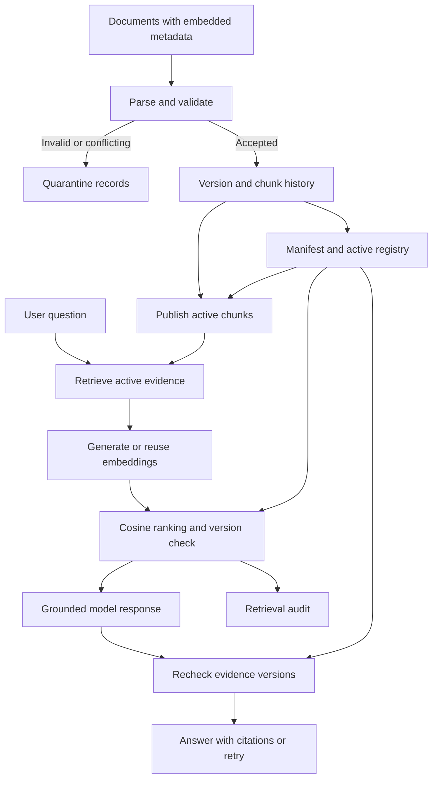

# Agriculture Document Retrieval

### Version-aware RAG on Databricks — a reusable framework with an agriculture demo

Retrieve knowledge from the latest eligible version of a document—even when its filename changes—while retaining earlier versions for traceability.

This project combines embedded document metadata, Delta-based version tracking, section-aware chunking, persisted embeddings, and grounded answers. It is organized as a set of focused Databricks notebooks in a Git folder: a centralized configuration notebook, reusable framework/ingestion/retrieval modules, and clearly separated demo and test notebooks. It was developed and demonstrated in Databricks Free Edition using real embedding and language-model inference.

**Core principle:** document eligibility is enforced by the data pipeline and retrieval logic before evidence reaches the model. A prompt alone does not decide which version is current.

> **Implementation and evidence:** This README describes the Python notebook project in this folder and its captured outputs, executed and validated in this workspace on October 31, 2026. It documents a notebook-hosted RAG framework, not a deployed autonomous agent or production service. All agriculture content and intervals are fictional demonstration data.

## Contents

- [Problem and value](#problem-and-value)
- [Framework](#framework)
- [Project structure and execution order](#project-structure-and-execution-order)
- [Configuration](#configuration)
- [How the pipeline works](#how-the-pipeline-works)
- [Metadata and version rules](#metadata-and-version-rules)
- [Data objects](#data-objects)
- [Quick start](#quick-start)
- [Demonstration and validation](#demonstration-and-validation)
- [Where it can be applied](#where-it-can-be-applied)
- [Platform, models, and dependencies](#platform-models-and-dependencies)
- [Operations and troubleshooting](#operations-and-troubleshooting)
- [Limitations and extensions](#limitations-and-extensions)

## Problem and value

A knowledge collection often contains several revisions of the same guide, policy, or operating procedure. Revised documents may have unrelated filenames. If every version remains searchable, an assistant can combine retired and current instructions or cite a plausible but outdated source.

This framework uses a stable business identifier inside each document to associate revisions. It selects the latest eligible business date, publishes only active-version chunks, and checks candidates against the authoritative registry before returning evidence.

| Challenge | Framework response |
|---|---|
| Filename changes across revisions | Identify the document using embedded `document_id` |
| Old documents arrive after new ones | Rank by business date rather than arrival time |
| Conflicting guidance across versions | Exclude inactive-version evidence |
| Historical records must be retained | Preserve version and chunk history in Delta |
| Invalid or ambiguous metadata | Record a quarantine reason and prevent publication |
| Readers need to verify an answer | Return source ID, version, date, section, and file path |

The design improves document freshness and traceability. It does not independently validate the accuracy of the source material or guarantee that every generated statement is supported.

## Framework

The framework has six stages:

| Stage | What it does | Main output |
|---|---|---|
| 1. Document sources | Read files with embedded JSON metadata | File content and metadata |
| 2. Ingestion and validation | Parse, hash, deduplicate, and detect conflicts | Accepted versions or quarantine records |
| 3. Version publication | Select the latest eligible revision per document ID | Manifest, registry, and active chunks |
| 4. Knowledge preparation | Split sections and generate missing embeddings | Chunk history and persisted vectors |
| 5. Controlled retrieval | Rank active chunks and validate their version/hash | Current supporting evidence |
| 6. Grounded answers | Provide evidence to a model and return citations | Answer, sources, evidence, and execution mode |



Embeddings are generated on demand during retrieval. They are not precomputed for every document at ingestion. A question scoped to one document ID generates missing vectors only for that document's active chunks.

## Project structure and execution order

The project is a set of focused Python notebooks in one Git folder. Numbered names give the execution order, and `%run` wires the reusable modules together — there is no package installation, and every notebook runs directly from a Databricks Git folder.

| Notebook | Kind | Purpose |
|---|---|---|
| `00_configuration` | Reusable | Single source of truth: namespace, Volume layout, model services, the document metadata contract (including configurable domain attributes), chunking and retrieval settings, and the project-scoped reset |
| `10_document_framework` | Reusable | Document contract, parsing/chunking/validation utilities, and `ensure_storage()` (Delta tables + manifest/registry views) |
| `20_ingestion_publication` | Reusable | `ingest_and_publish()` and active-chunk publication, with a guarded operational entry |
| `30_retrieval_answers` | Reusable | Embedding-aware, registry-validated retrieval (`search_current_documents()`) and grounded answers (`ask()`) |
| `40_demo_generation` | Demo/test | Agriculture fixtures, V1/V2 ingestion, the baseline 8-day answer, and the controlled V2 → V3 update with assertions |
| `45_robustness_checks` | Demo/test | Regression tests: late-arriving old files, invalid metadata, conflicting content, future dates, embedding reuse, ingestion idempotency, and automatic fixture cleanup |
| `50_inspect_audit` | Inspection | Displays the manifest, quarantine records, and retrieval audit |

Dependency chain (`%run`):

```text
00_configuration
  └── 10_document_framework
        ├── 20_ingestion_publication ─┐
        ├── 30_retrieval_answers ─────┤
        │                             └── 40_demo_generation ── 45_robustness_checks
```

The operational notebooks (00–30) are definitions-only: running or `%run`ning them never generates synthetic files or injects test fixtures into the landing directory. All file generation and adversarial inputs live in `40`/`45`, so an operational ingestion job cannot accidentally fabricate documents.

`45_robustness_checks` writes its four adversarial files into `landing/` for the test batch and removes them (`cleanup_robustness_fixtures()`) when the run finishes, so a normal ingest pass after testing never encounters intentionally invalid or conflicting files. Legitimate source files and accepted history (including the inactive future-dated version) are preserved, and quarantine observations remain in the table as historical records (deduplicated on re-runs).

### First run

1. Run `00_configuration` — creates the dedicated schema, Volume, and `landing/`/`staged_updates/` directories (idempotent).
2. Run `10_document_framework` — creates the Delta tables and views (idempotent).
3. Run `40_demo_generation` top to bottom — generates fixtures, ingests V1/V2, answers the baseline question from V2, publishes V3 from a different filename, and asserts the answer flip. All assertions must pass.
4. Run `45_robustness_checks` — regression tests (it re-executes the idempotent demo notebook first when run standalone).
5. Optionally run `50_inspect_audit` to browse the manifest, quarantine, and audit.

On a fresh schema, running `40` alone is sufficient — it `%run`s 00/10/20/30 first. `50` only needs `00`.

### Repeat the demo (reset procedure)

The active-version flip can only be demonstrated once per schema state (V3 stays active afterwards). To repeat it:

1. Run `00_configuration`.
2. Execute `reset_project_data(confirm=True)` in the configuration notebook. This drops and recreates **only** the configured `<catalog>.<schema>` and its Volume — all project tables, views, stored embeddings, and fixture files are deleted. It refuses to run when `SCHEMA` is empty or `default` and never touches unrelated workspace objects.
3. Run `10_document_framework` (recreates tables/views) and then `40` and `45`.

Alternatively, set a fresh `SCHEMA` in `00_configuration` for a fresh baseline while keeping the old one. The reset procedure reuses the same schema name; a fresh schema adds a new one.

### Operational ingestion

To ingest real files operationally: place UTF-8 `.md`/`.txt` files in `landing/` and run `20_ingestion_publication` with `AUTO_RUN_INGESTION = True` (or call `ingest_and_publish()` from a thin job-task notebook). Exclude `40`/`45` from operational jobs. Limit the workflow to one publisher and control other writers; the notebook-local lock does not coordinate separate jobs or users. `AUTO_RUN_INGESTION` defaults to `False`, so `%run`ning `20` from the demo or test notebooks only defines the functions; `00_configuration` defines no override for this flag (verified: with `True` exactly one ingest pass runs per execution; with the default `False` none runs).

## Configuration

All settings live in `00_configuration`:

| Setting | Default | Meaning |
|---|---|---|
| `CATALOG` | currently selected catalog | Project catalog (empty string = current catalog) |
| `SCHEMA` | `agri_retrieval_poc` | Dedicated project schema |
| `VOLUME` | `documents` | Unity Catalog Volume holding `landing/` and `staged_updates/` |
| `LANDING_DIR` / `STAGED_DIR` | `landing` / `staged_updates` | Scanned by ingestion / demo-only holding area never scanned |
| `AI_MODE` | `auto` | `off` disables model calls (keyword retrieval + cited excerpts only — a labeled fallback, not a full RAG demonstration) |
| `EMBEDDING_MODEL` | `system.ai.gte-large-en` | Native model service used via SQL `ai_query` |
| `CHAT_MODEL` | `system.ai.gpt-oss-20b` | Native model service used for grounded answers |
| `CORE_METADATA_FIELDS` | `document_id`, `version_id`, `document_date` | Required identity fields for every domain |
| `DOMAIN_ATTRIBUTES` | `title`, `crop`, `region`, `topic` | Configurable domain metadata fields; drive validation and generated table schemas |
| `CHUNK_MAX_WORDS` / `CHUNK_OVERLAP_WORDS` | 180 / 30 | Section-aware chunking window settings |
| `DEFAULT_TOP_K` / `CANDIDATE_POOL_LIMIT` | 3 / 20 | Evidence chunks per answer / candidates ranked before registry validation |

**Retargeting to another domain:** change `DOMAIN_ATTRIBUTES` (and write a domain-appropriate fixture generator alongside `40_demo_generation`, which assumes the agriculture attributes). `parse_document` validation and every history-table schema derive from the configured contract, so a domain change requires no edits to the framework, ingestion, or retrieval modules. Note that `chunk_document` prepends the record's `title` to each chunk's searchable text — keep `title` in the domain attributes or adapt that step. Domain attributes are retained with every version and chunk but are not retrieval filters; the only retrieval filter is an optional `document_id`.

## How the pipeline works

### 1. Read the document's own metadata

The ingestion module discovers UTF-8 `.md` and `.txt` files in a Unity Catalog Volume landing directory. Each file starts with a visible metadata block. A deterministic parser separates the JSON header from the body; a model is not needed to infer the identifier or date.

### 2. Validate and retain accepted versions

The ingestion process checks required metadata, parses the document date, rejects empty bodies, and calculates a SHA-256 hash of the full decoded document text, including metadata.

The batch is compared with previously accepted records. Identical versions are deduplicated. Conflicting contents for the same version key and different versions claiming the same document date are quarantined.

Chunks are inserted before version metadata so an interrupted run can be repaired by rerunning ingestion. The writes are idempotent, but they are not a single transaction across all tables.

### 3. Publish the latest eligible version

A manifest view ranks versions within each `document_id`. The highest date at or before the Spark session's current date is active. A registry exposes its version and hash.

A SQL `MERGE` refreshes the active chunk table: it inserts current chunks and removes retired chunks from the retrieval source. Historical versions and their chunks remain stored separately.

### 4. Chunk and embed

The custom chunker splits on top-level Markdown section headings. Long sections are divided into windows of up to **180 body words**, with **30-word overlap** (both configurable). The title is prepended to each chunk's searchable text. Chunk IDs are deterministic hashes incorporating business ID, version, document hash, section position, and window position.

For semantic retrieval, `ai_query` calls `system.ai.gte-large-en`. Missing vectors are persisted in Delta by chunk ID and model name. Question vectors are cached in memory during the notebook session. The implementation normalizes cosine similarity at comparison time; it does not assume model vectors are unit-normalized.

### 5. Retrieve only eligible evidence

`search_current_documents()` reads the active chunk pool, optionally filters by document ID, and ranks candidates using exact cosine similarity. The default answer uses up to three chunks.

Every accepted candidate must match the registry's `(document_id, version_id, content_hash)`. Historical vectors may remain in storage, but inactive chunks are excluded from the candidate pool. The current project does not use an external vector database or Databricks AI Search index.

### 6. Answer and revalidate

`ask()` passes validated excerpts and source metadata to `system.ai.gpt-oss-20b` through `ai_query`. The instructions require grounded answers, source citations, and abstention when the evidence does not support the question.

Evidence is validated again after generation. If it has been superseded, the answer is discarded and the caller receives a retry response. This check supports the single-process demonstration; it is not a distributed transactional consistency guarantee.

## Metadata and version rules

### File contract

```text
---metadata
{
  "document_id": "AGR-001",
  "version_id": "AGR-001-V3",
  "document_date": "2026-07-15",
  "title": "Wheat Irrigation Demo Guide",
  "crop": "wheat",
  "region": "demo-region",
  "topic": "irrigation"
}
---
# Review interval
The irrigation review interval for wheat is 6 days.
```

| Field | Meaning |
|---|---|
| `document_id` | Stable business key across revisions and filenames (core) |
| `version_id` | Immutable revision identifier within the business document (core) |
| `document_date` | Business date used to select the current version; supply `YYYY-MM-DD` (core) |
| `title` | Human-readable document title (domain attribute; also prepended to chunk text) |
| `crop`, `region`, `topic` | Agriculture domain attributes retained with the document and chunks |

All metadata fields (core + configured domain attributes) are required nonempty strings. `is_active` is computed by the pipeline, not accepted from the file. Dates are stored as strings; consistently formatted ISO dates are necessary for correct ordering. Production ingestion should enforce the exact date format or use a typed `DATE` column.

### Publication behavior

| Situation | Current behavior |
|---|---|
| Newer eligible business date | Publish the newer successfully accepted version |
| Older revision arrives late | Retain/deduplicate it without changing the active version |
| Identical revision under a new filename | No additional version or chunk record; first accepted source path remains |
| Same document/version, changed content | Quarantine incoming conflicting records |
| Different versions share a document date | Quarantine the ambiguous incoming records |
| Invalid incoming update | Preserve the previously accepted version |
| Future-dated revision | Store as history; keep inactive until its date is eligible |
| Source file disappears | Previously accepted history remains; no withdrawal behavior is implemented |

An ambiguous incoming batch rejects all files claiming the conflicting key, including a valid-looking sibling. An already accepted version remains available. Quarantine records do not themselves revoke existing accepted history, and historical quarantine entries do not mean the accepted document is invalid.

The manifest's date eligibility changes with the current date. The **physical active chunk table still requires publication to run**. Schedule `ingest_and_publish()` when future-dated versions must activate; registry validation will reject a stale physical version in the interim, potentially leaving no usable evidence.

## Data objects

Objects live under `<catalog>.<schema>`. Defaults use the currently selected catalog and schema `agri_retrieval_poc`.

| Object | Type | Purpose |
|---|---|---|
| `documents` | Unity Catalog Volume | `landing/` source files and `staged_updates/` fixtures |
| `document_versions` | Delta table | Immutable accepted metadata, body, hash, and source details |
| `document_manifest` | SQL view | Version history with rank and computed `is_active` |
| `active_document_registry` | SQL view | Current document ID, version, hash, and date |
| `document_chunks` | Delta table | Chunk history for **every** accepted document, active or not |
| `active_document_chunks` | Delta table | Published retrieval source containing active chunks only |
| `chunk_embeddings` | Delta table | Embeddings stored as JSON strings, keyed by chunk/model |
| `quarantined_documents` | Delta table | Source path, content hash, reason, and observation timestamp |
| `retrieval_audit` | Delta table | Questions, retrieval mode, candidate refs, accepted refs, and rejected count |

Table schemas are generated from the metadata contract, so adding a domain attribute grows every history table consistently. The active chunk table has Change Data Feed enabled, but no streaming CDC consumer or Delta Sync search index is implemented.

## Quick start

### Requirements

- A Databricks notebook environment with serverless compute and Unity Catalog access.
- Permission to create the dedicated schema, Volume, tables, and views.
- Access to the configured native model services for the full semantic RAG path.

No notebook-level package installation, external API key, model download, or additional serving/search endpoint is required. Cloning/branching this Git folder is sufficient.

### Run

Follow the [execution order](#project-structure-and-execution-order): `00` → `10` → `40` → (`45`) → (`50`). On a fresh schema, `40` alone is sufficient because it `%run`s the reusable modules first.

### Ask questions

```python
result = ask("What is the irrigation review interval for wheat?", "AGR-001")
print(result["answer"])
print(result["sources"])
print(result["mode"])

# Search across all current documents:
ask("What should happen if a demonstration sensor reading is missing?")

# Request current evidence without generating an answer:
search_current_documents("wheat irrigation review interval", "AGR-001", k=3)
```

Domain attributes such as `crop`, `region`, and `topic` are retained metadata. Dedicated retrieval filters for those fields are not implemented; the current function provides only an optional document-ID filter.

### Interpret execution modes

| Location | Mode | Meaning |
|---|---|---|
| Retrieval audit | `SEMANTIC` | Real embeddings and cosine ranking were used |
| Retrieval audit | `TFIDF` | Keyword-based fallback was used |
| Answer response | `GROUNDED_LLM` | A language model generated the answer from supplied evidence |
| Answer response | `EXTRACTIVE` | The response contains cited excerpts rather than generated synthesis |
| Answer response | `RETRY` | Evidence changed before the answer was released |

Retrieval and answer modes are independent: a generated answer could use TF-IDF evidence, and semantic retrieval could return excerpts if chat is unavailable. Check both to demonstrate the full RAG path. Fallback execution is always labeled — never report a full RAG success unless semantic retrieval and LLM-generated answers actually ran.

## Demonstration and validation

The fixtures intentionally give the same question different answers across revisions:

| Revision | Document date | Synthetic review interval |
|---|---|---|
| AGR-001-V1 | 2026-01-15 | 10 days |
| AGR-001-V2 | 2026-04-15 | 8 days |
| AGR-001-V3 | 2026-07-15 | 6 days |

### Evidence captured in the validated runs

**Run 1 — original single-notebook implementation (October 31, 2026):**

| Check | Observed result |
|---|---|
| Initial ingestion | 10 accepted versions across 5 IDs; no quarantine records |
| Baseline answer | 8 days, citing AGR-001-V2 and its date/section; `GROUNDED_LLM` |
| Renamed V3 publication | `new_field_manual_1.md` activated AGR-001-V3 |
| Updated answer | 6 days, citing AGR-001-V3; `GROUNDED_LLM` |
| Stale candidate rejection | Explicit V2 candidate rejected by the registry validator |
| Active chunk cleanup | No AGR-001 V1/V2 chunks remained in the active source |
| Repeated ingestion | Version and chunk counts remained unchanged |
| Invalid metadata | `broken_metadata.md` recorded `Missing or invalid version_id` |
| Conflicting V3 | Conflicting file and same-key sibling recorded conflict reasons; accepted V3 remained current |
| Future-dated document | AGR-006 retained as history and inactive at the captured run date |
| Final state | 12 version records, 3 quarantine records, and 6 retrieval audit rows |
| Retrieval path | All 6 captured audit rows were `SEMANTIC` |

**Run 2 — restructured multi-notebook project, enhancement branch (October 31, 2026, including the Stage 1 close-out):** schema reset with `reset_project_data(confirm=True)`, then `40_demo_generation` and `45_robustness_checks` (with automatic fixture cleanup) executed end to end.

| Check | Observed result (notebook assertion or SQL-verified) |
|---|---|
| Demo run | Completed with all assertions passing; 3 retrieval audit rows, all `SEMANTIC` |
| Baseline answer evidence | First audit row accepted only `AGR-001-V2` chunks (8-day baseline evidence) |
| V3 publication | `AGR-001` active on V3 (2026-07-15); zero non-V3 AGR-001 chunks in the active pool (SQL) |
| Answer flip | Assertions: sources cite only V3; evidence contains only the 6-day interval; no 8/10-day text in active chunks |
| Idempotency | Re-ingesting unchanged files added no rows (asserted twice) |
| Embeddings | 6 stored vectors (3 V2 + 3 V3 chunks); row count unchanged across a repeated question (asserted — missing-vector logic) |
| Late arrival | `late_arrival_legacy_1.md` accepted as history; AGR-001 stayed on V3 (assertion) |
| Invalid metadata | `broken_metadata.md` quarantined `Missing or invalid version_id` (SQL) |
| Conflicting V3 | `conflicting_v3.md` and sibling `new_field_manual_1.md` quarantined `Conflicting version content` (SQL) |
| Future-dated document | AGR-006 stored with business date 2026-11-30 (run date + 30 days) and inactive (SQL) |
| Robustness run | All assertions passed, including a final `GROUNDED_LLM` answer citing only V3 |
| Fixture cleanup | The four adversarial files were removed from `landing/`; the post-cleanup ingest pass reported 0 quarantined files and added no quarantine records (observed) |
| Operational ingestion instructions | Running `20_ingestion_publication` with `AUTO_RUN_INGESTION = True` executed exactly one ingest pass; with the default `False` no pass ran; `00_configuration` sets no overriding flag (observed) |
| Final state | 12 version records, 3 quarantine records (historical observations), 8 audit rows — all `SEMANTIC` (SQL) |

These are observations from full sequential executions in this workspace, not a complete accuracy benchmark. Stable embedding row counts show no additional stored vectors; alone they do **not** prove that no inference requests occurred. The code's missing-vector check supports reuse; stronger verification would count model calls. The captured vectors cover queried AGR-001 versions, not all five documents.

The future-dated fixture now uses a business date **relative to the test run** (current date + 30 days), so the future-inactive check never expires and needs no manual date maintenance.

### Suggested demo narrative

1. Show V1/V2 history and explain why filenames are not business identifiers.
2. Ask the wheat question and show the 8-day answer, V2 citation, and semantic audit record.
3. Publish V3 with a different filename.
4. Ask the identical question and show the 6-day answer and V3 citation.
5. Show that old content remains in history but is absent from current retrieval.
6. Show late-arrival, quarantine, and future-date tests without presenting their files as production inputs.

## Where it can be applied

The pattern is reusable wherever users need **current approved knowledge with retained history**. The examples below are potential applications, not implemented integrations.

| Domain | Example documents | Why version control matters |
|---|---|---|
| Agriculture | Crop guides, field procedures, equipment manuals | Avoid superseded practices or obsolete maintenance instructions |
| Manufacturing | SOPs, work instructions, maintenance bulletins | Retrieve the current procedure for a process or asset |
| Contact centers | Product FAQs, routing guides, agent knowledge articles | Keep answers aligned with current customer-service guidance |
| Insurance and healthcare operations | Plan guides, enrollment procedures, administrative policies | Distinguish current plan-year and operational documents |
| HR and enterprise support | Benefits guides, onboarding instructions, IT runbooks | Prevent answers from retired policies |
| Engineering and professional services | Specifications, standards, delivery playbooks | Tie answers to the current released revision |

For these applications, define the business key carefully. A regional guide or plan-year document may require `(document_id, region, language, product, effective_period)` as its eligibility scope. A single global latest revision may be inappropriate.

Likewise, the newest file is not necessarily approved or effective. Add explicit approval, effective-date, expiry, withdrawal, and access rules before using this pattern for governed operational decisions. Those lifecycle controls are outside this project.

## Platform, models, and dependencies

| Component | Implementation |
|---|---|
| Storage and governance | Databricks Delta tables and Unity Catalog Volume |
| Model invocation | Built-in SQL `ai_query` |
| Embedding model | `system.ai.gte-large-en` |
| Answer model | `system.ai.gpt-oss-20b` |
| Parsing, chunking, ranking, and validation | Custom Python using the standard library |
| Search SDK / vector database | None |
| Deployed agent endpoint or chat application | None |

The underlying GTE and GPT-OSS model families publish Apache-2.0 weights. Databricks-hosted inference and the workspace are managed proprietary services; using open model weights does not make the whole stack open source. No third-party library license is required because this version adds no packages.

Free Edition provides a no-cost, quota-limited environment. Availability can differ by workspace; the captured notebook executions demonstrate both configured models working in this user's workspace. Hosted inference uses the available quota, and ordinary charges can apply if the project is run in a paid workspace. Free Edition is intended for non-commercial use; commercial deployments require an appropriate environment. See the current [Free Edition limits](https://docs.databricks.com/aws/en/getting-started/free-edition-limitations).

The [embedding-query documentation](https://docs.databricks.com/aws/en/machine-learning/model-serving/query-embedding-models) documents SQL embedding invocation and labels that interface Public Preview as of this review. Do not describe every component as generally available or the selected models as the latest released weights. Recheck model names and feature status when reproducing the project.

## Operations and troubleshooting

| Symptom | What to check |
|---|---|
| Baseline already answers 6 days | V3 is already published. Reset the project (see the [reset procedure](#repeat-the-demo-reset-procedure)) or use a fresh `SCHEMA`. |
| Model unavailable or quota error | Inspect printed diagnostics and execution modes. Retry after access/quota recovery. |
| A recovered model is still disabled | Rerun `30_retrieval_answers` (or the notebook that uses it); failed paths stay disabled for that session. |
| No evidence after a date transition | Run `ingest_and_publish()` to refresh physical active chunks. |
| Three quarantine records after robustness tests | Historical observations only — `45` removes its fixture files from `landing/` automatically; the quarantine table preserves the records, and re-runs deduplicate them. |
| Want to change an accepted document | Publish a new `version_id` and a distinct business date; do not overwrite a revision. |
| New model or configuration | Rerun `00_configuration` and the retrieval module so in-memory model state and the query-vector cache reset. |

`45_robustness_checks` cleans up its four fixture files automatically; nothing needs to be moved after testing. Keep the accepted `new_field_manual_1.md`; its quarantine entry reflects the ambiguous test batch, not invalid accepted history. The current code does not automatically clear resolved quarantine entries or move files into a quarantine folder.

For scheduled ingestion, run `20_ingestion_publication` with `AUTO_RUN_INGESTION = True` (or a thin driver notebook calling `ingest_and_publish()`) as a job task. Exclude fixture generation and the demo/robustness notebooks. Limit the workflow to one publisher and control other writers; the notebook-local lock does not coordinate separate jobs or users. Notebook-source control in Git does not version the Volume contents or Delta data.

## Limitations and extensions

| Current limitation | Useful next extension |
|---|---|
| Markdown/plain-text only | Add PDF/DOCX extraction and OCR, preserving page references |
| Driver scans and collects the corpus | Add incremental ingestion and distributed processing |
| Exact in-Python cosine search | Use a managed AI Search index when scale justifies it |
| Date-based version selection | Introduce approval status, effective windows, expiry and revocation |
| No distributed publication protocol | Publish coordinated generations and define freshness/consistency guarantees |
| No score threshold or semantic answerability evaluation | Add relevance thresholds, abstention tests, and groundedness evaluation |
| Citation formatting is prompted | Validate citations against supplied sources programmatically |
| No document-level access filter | Enforce authorization before retrieval and model context assembly |
| Retrieval-only audit | Add model identity/revision, answer mode, latency, inference usage, and evaluation outcomes |
| Model name is the vector cache key | Track immutable embedding model revisions and re-embed after model changes |

Free Edition currently permits a limited AI Search endpoint; this project omits it because exact search is sufficient for the small corpus, not because the service is categorically unavailable.

Planned but **not implemented** on this branch yet: a reusable evaluation harness with persisted results, curated operational views/observability, an AI/BI dashboard, and a Genie analytics asset over the operational views.

Additional scope boundaries:

- Semantic search returns the highest-ranked chunks even for weakly related questions. Generation is instructed to abstain, but no support validator enforces that instruction.
- The local lock and post-generation check do not make responses linearizable across external writers. A publication can still occur after the final check.
- Crop/region filtering, multilingual processing, historical “as of” queries, UI deployment, tool-calling orchestration, and MLflow evaluation are not implemented.
- Quarantine is not a complete ingestion-event ledger. Individual file read failures outside the parse exception handler can stop a run.
- Retiring or removing a document requires an explicit lifecycle extension; deleting its source file alone does not remove accepted knowledge.

## References

- [Databricks Free Edition limits](https://docs.databricks.com/aws/en/getting-started/free-edition-limitations)
- [Query an embedding model](https://docs.databricks.com/aws/en/machine-learning/model-serving/query-embedding-models)
- [Use ai_query](https://docs.databricks.com/aws/en/large-language-models/ai-query)
- [Supported foundation models](https://docs.databricks.com/aws/en/machine-learning/foundation-model-apis/supported-models)
- [Unity Catalog Volumes](https://docs.databricks.com/aws/en/volumes/)
- [Delta Lake on Databricks](https://docs.databricks.com/aws/en/delta/)
- [GTE model card and license](https://huggingface.co/Alibaba-NLP/gte-large-en-v1.5)
- [GPT-OSS model card and license](https://huggingface.co/openai/gpt-oss-20b)

**Project placement:** This README lives at the root of `agri-document-retrieval` alongside the numbered project notebooks (`00_configuration` … `50_inspect_audit`). Keep the notebook sources under Git version control rather than relying on exports; the earlier single-notebook implementation remains in the repository history. The Stage 1 restructure and its close-out are committed on the `reusable-framework-dashboard` enhancement branch.
